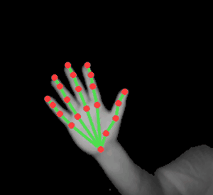

# leap-jetson

[](LICENSE)
[](https://doi.org/10.5281/zenodo.24050502)


<p align="center"></p>

3D hand tracking for the **original Leap Motion Controller** (LMC1, USB `f182:0003`) on **NVIDIA Jetson
GPUs**: TensorRT FP16, no Ultraleap software.

Ultraleap never shipped hand tracking for this controller on ARM Linux, and its download servers are
gone. leap-jetson reads the controller as a plain USB camera, runs Monado's open "Mercury" hand models
in TensorRT, and triangulates 21 joints per hand with the calibration stored on the controller.

> **Status: working prototype.** Last validated 2026-11-09 on a Jetson AGX Xavier (JetPack 5.1,
> L4T 35.6.5, MAXN, GPU clock pinned). With a hand in view, live tracking runs at about 80 fps (the camera
> delivers 115). 3D is accurate with the hand 20–30 cm above the controller; it degrades with distance
> (see [Limits](#limits)).

*Not affiliated with, endorsed by or supported by Ultraleap. Leap Motion is a trademark of its owner.*

## Results

| | |
|---|---|
| Camera | 640×240 per eye at 115 fps (UVC, `uvcvideo`) |
| Tracking rate, hand in view | **about 80 fps** (76–82 fps in three 20 s runs, GPU clock pinned) |
| Latency, camera frame → 3D joints | 14.5 ms median (14.2–14.6 ms) |
| Processed frames with a 3D hand | 90–98% |
| FP16 TensorRT vs ONNX FP32 | joints differ by 0.04 px on average (max 1.6 px) |
| Stereo consistency | 0.76–0.85 px median between the eyes |
| Bone lengths, hand 23–26 cm above | index finger 38–39 / 24 / 21 mm; wrist to middle knuckle 89–90 mm in two runs, 103 mm in the third |

Each figure, the run it comes from and the method are in [docs/RESULTS.md](docs/RESULTS.md). An earlier
version reached 98 fps and 14 ms by tracking each eye on its own, but gave a 3D hand on only 77% of its frames,
with the eyes 2.56 px apart. Tracking the eyes together costs speed and gives more usable frames.

## Tested on

| Board | JetPack / L4T | TensorRT | Python | Controller firmware | Status |
|---|---|---|---|---|---|
| Jetson AGX Xavier (32 GB) | 5.1 / 35.6.5 | 8.5.2 | 3.8 | 1.7.1 | working |
| Jetson Orin family | 6.x | — | — | — | untested |

## How it works

```text
uvcvideo YUYV 640x240 @115 fps  (even bytes = left eye, odd bytes = right eye)
  -> each eye: stretch to 640x480, rotate 180°                       mercury.prepare_eye
  -> hand detector 160x160          TensorRT FP16                     pipeline.EyeTracker
  -> 128x128 crop -> 21 keypoint heatmaps (FP16), both handedness orientations,
     previous joints as a temporal prior, coasting when the detector loses a far hand
  -> both eyes: undistort the 21 joints with the controller's own lens model,
     rectify, triangulate (baseline 40 mm)                            stereo.triangulate
  -> eyes disagree: the confident eye places the other eye's crop
     through the 3D hand, keypoints again; still > 3 px: no 3D         stereo_tracker.StereoTracker
```

- **Calibration** lives on the controller (156 bytes). It is read with two standard UVC control requests
  (`tracker/leap_usb_calib.py`). Linux's `uvcvideo` caches control values, so the read goes through libusb
  and detaches the driver for about a second.
- **Orientation:** a controller lying face up sees hands upside down compared with Mercury's training
  views. The detector needs the binned 640×240 image stretched back to 640×480 and rotated by 180°:
  median detector score 0.74 against 0.006 for the raw image.
- **Only keypoints are undistorted** (21 per eye), never whole images.

## Requirements

- An original Leap Motion Controller. Tested only with firmware **1.7.1**, which streams as a plain UVC
  camera. Older firmware may stay silent until a bring-up sequence is sent (OpenLeap documents one for
  1.7.0) or need a firmware update. This project never flashes firmware.
- A Jetson with JetPack 5: system Python 3.8 with TensorRT 8.5 and OpenCV, plus numpy and libusb-1.0.
- Write access to the controller's USB device node, e.g. a udev rule:
  `SUBSYSTEM=="usb", ATTRS{idVendor}=="f182", ATTRS{idProduct}=="0003", GROUP="plugdev", MODE="0660"`.
- No Ultraleap service (`leapd`, `libtrack_server`) running: they detach `uvcvideo` from the controller.
  Replug the controller after one has run.

## Quick start

1. **Models (not included).** Download Monado's models yourself and check them against the
   checksums this project was tested with:
   ```bash
   git clone https://gitlab.freedesktop.org/monado/utilities/hand-tracking-models.git
   git -C hand-tracking-models checkout 37a8a81
   (cd hand-tracking-models && sha256sum -c ../models.sha256)
   ```
2. **Engines.** Build the TensorRT engines on the Jetson itself (they are specific to the GPU and the
   TensorRT version):
   ```bash
   bash tracker/build_engines.sh hand-tracking-models
   ```
3. **GPU clock.** The Jetson's GPU governor keeps the clock low for this short, bursty load (about
   217 MHz on a Xavier, about 3× slower). Raise the minimum for the session (root, until reboot):
   ```bash
   G=/sys/devices/17000000.gv11b/devfreq/17000000.gv11b   # AGX Xavier; other boards differ
   cat $G/max_freq | sudo tee $G/min_freq
   ```
4. **Calibration.** Read it from the controller:
   ```bash
   python3 tracker/leap_usb_calib.py -o calibration.bin
   ```
5. **Run.** Find the video node with `v4l2-ctl --list-devices`, then:
   ```bash
   python3 tracker/live_track.py --calib calibration.bin --models hand-tracking-models \
       --device 6 --seconds 20 --out frames.jsonl --snapshots snapshots/
   ```
   `frames.jsonl` holds one line per frame: 3D joints in mm (left-camera frame), per-eye 2D joints,
   confidences and the stereo mismatch. TensorRT engines and recordings stay on your device; this
   project never distributes engines.

## Try it without the hardware (replay)

`live_track.py` can play a raw recording instead of the camera, and run Monado's ONNX files with ONNX
Runtime instead of TensorRT, so it runs on an ordinary PC:

```bash
pip install onnxruntime opencv-python-headless numpy
python3 tracker/live_track.py --backend ort --replay rec.raw --every-frame \
    --calib calibration.bin --models hand-tracking-models --out frames.jsonl --snapshots snapshots/
```

On a desktop CPU this processes about 43 frames per second. A recording also needs the calibration
of the controller that made it.

A sample to try it with is attached to the
[v0.1.0 release](https://github.com/OomAngel/leap-jetson/releases/tag/v0.1.0):
`leap-jetson-sample-v1.zip` (3.8 MB) holds 460 frames (4 s) and that controller's calibration. Each frame
is masked to the hand, so the forearm is cut off and the wrist reads a little off: use it to try the
tracker, not to measure accuracy. Its `README.txt` has the command and the measurements.

## Tools

| Script | What |
|---|---|
| `tracker/live_track.py` | live tracking or `--replay`; TensorRT or `--backend ort`; JSON lines, stats, annotated snapshots |
| `tracker/leap_usb_calib.py` | reads the controller's calibration over libusb |
| `tracker/build_engines.sh` | builds TensorRT engines from the ONNX models with `trtexec` |
| `tracker/check_precision.py` | ONNX Runtime FP32 vs TensorRT FP32 vs FP16 on a recording |
| `tracker/probe_detector.py` | detector score for each image geometry |
| `tracker/fit_lens_model.py` | chooses how to read the stored lens model (stereo mismatch, bone-length spread) |
| `tracker/mask_recording.py` | cuts a section of a recording and blacks out everything but the hand, frame by frame |
| `tracker/plumb_line.py` | plumb-line test of the lens model: straight edges of a sheet must stay straight |
| `tests/` | CPU-only unit tests (decoding, geometry, triangulation, calibration parsing, replay): `pytest` |

Record raw frames for the offline tools with
`v4l2-ctl -d /dev/video6 --set-fmt-video=width=640,height=240,pixelformat=YUYV --stream-mmap --stream-count=1150 --stream-to=rec.raw`.

## Limits

- **Distance:** depth resolution falls with the square of the distance. With the controller's 40 mm
  baseline and a 134 px focal length at this resolution, one pixel of stereo disagreement is 12 mm of
  depth at 25 cm and 23 mm at 35 cm. Depth noise lengthens bones on average: wrist to middle knuckle measures
  88–91 mm at 20–30 cm, 101 mm at 30–35 cm and about 109 mm at 33 cm. Keep the hand 20–30 cm above the
  controller for measurements. One of three live runs read 103 mm at the same depth, for a reason not yet
  known, so do not rely on a single run's bone lengths.
- **Eyes that disagree:** far, side-on hands against a cluttered background (the arm, a lamp) can make one
  eye's tracker drift onto the forearm. The eyes are tracked together (`tracker/stereo_tracker.py`): when
  they disagree, the more confident eye places the other eye's crop through the 3D hand and the keypoint
  model runs again there. Frames that still disagree by more than 3 px get no 3D (`--max-epipolar`):
  2.5% of a normal recording, 2.4% of a far, side-on one ([docs/RESULTS.md](docs/RESULTS.md)). After a
  good frame, both crops follow the 3D hand without the detector, which makes repairs rare and frames
  cheaper.
- **Lens model:** the controller's images are already nearly rectilinear. A plumb-line test (straight
  sheet edges through the whole view) puts the stored radial correction at 0.1 of its nominal strength
  (`tracker/plumb_line.py`); the full correction bends straight edges by half again as much.
- One hand is tracked. The detector has two slots, but the 3D path takes the best hand per eye.
- Fists and heavily occluded poses are the weakest, as in any keypoint model.
- No smoothing in 3D yet.

## Roadmap

1. 3D smoothing (One-Euro filter), which also reduces the bone lengthening at distance, and two hands.
2. ROS 2 node publishing `/hand_tracking/raw`.
3. Test on Jetson Orin (JetPack 6).

## Fallback: Ultraleap V2 under box64

If you need Ultraleap's own tracking on a Jetson, the 2015 V2 service (x64) runs under the box64 emulator
at 80–90 fps once a box64 race is fixed. Newer Ultraleap services do not run there. See
[fallback_v2_box64/](fallback_v2_box64/README.md). This route uses Ultraleap's software and is governed
by its licence terms; you obtain that software yourself. The box64 bugs found on the way are reported
upstream: [#4574](https://github.com/ptitSeb/box64/issues/4574) (the race the patch fixes) and
[#4573](https://github.com/ptitSeb/box64/issues/4573) (16-byte atomics, met with newer Ultraleap services).

## Licence and credits

- Code in this repository: **Apache-2.0** (see `LICENSE` and `NOTICE`).
- **Hand models:** Monado's Mercury models (`grayscale_detection_160x160.onnx`,
  `grayscale_keypoint_jan18.onnx`, commit `37a8a81`) from the Monado project,
  https://gitlab.freedesktop.org/monado/utilities/hand-tracking-models. **Not included;** you download
  them yourself. **Licence unconfirmed, question pending:** the upstream repository carries no licence
  file, and OpenLeap describes the models as CC BY-SA 4.0. The Monado maintainers were asked on
  2026-10-10 ([issue #1](https://gitlab.freedesktop.org/monado/utilities/hand-tracking-models/-/work_items/1));
  this section will be updated with their answer.
- Model conventions follow Monado's Mercury (BSL-1.0) as documented by
  [OpenLeap](https://github.com/julianjc84/OpenLeap) (BSL-1.0).
- The calibration read follows the controller behaviour described by Leap Motion's LeapUVC; no LeapUVC
  code is used, and frames come from the kernel's `uvcvideo` driver, never from LeapUVC.
- `fallback_v2_box64/box64-cleanup-lock.patch` modifies box64 (MIT, see `fallback_v2_box64/LICENSE.box64`).

Details in [THIRD_PARTY_NOTICES.md](THIRD_PARTY_NOTICES.md) and [docs/LEGAL.md](docs/LEGAL.md) (not legal
advice).

## Citation and support

Use GitHub's "Cite this repository" (from `CITATION.cff`). One maintainer, best effort: report bugs with
the issue form, which asks for your board, JetPack, TensorRT and model versions.
